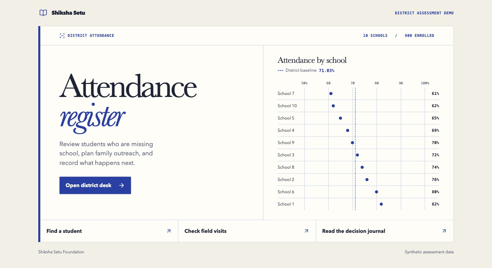
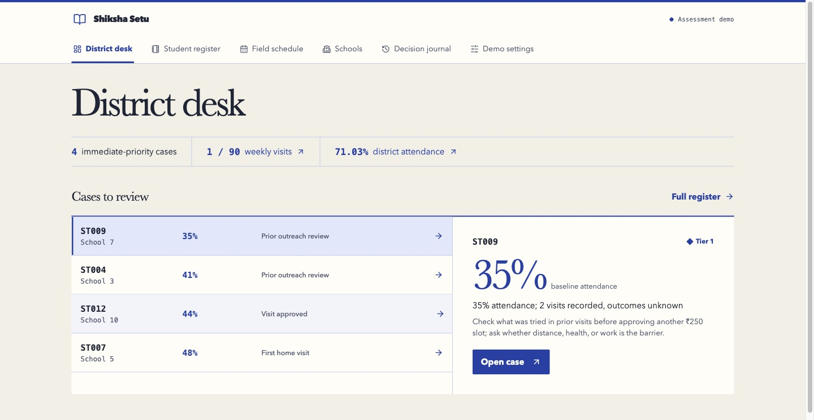
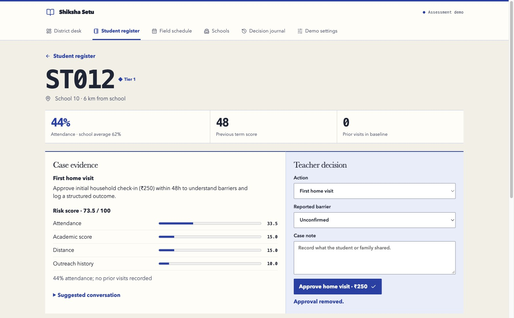
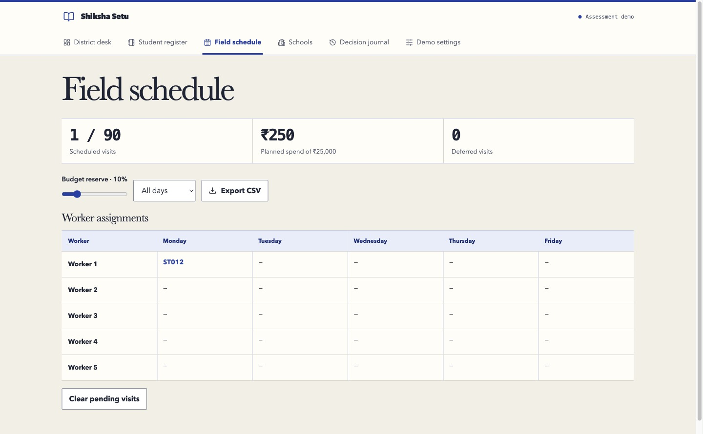
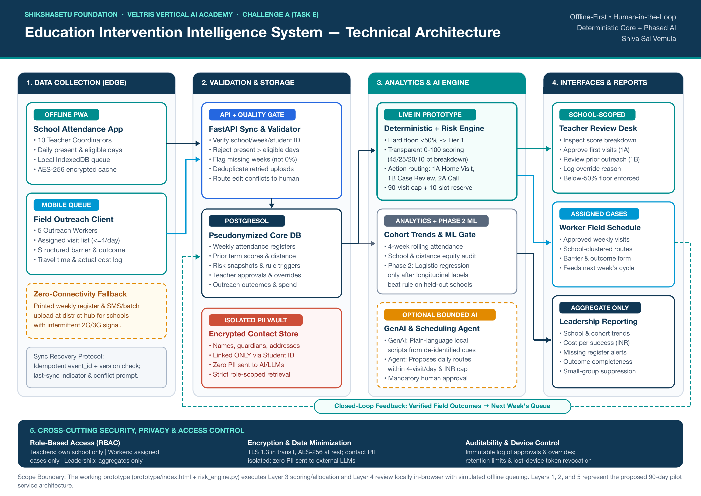

# Shiksha Setu

Shiksha Setu is an attendance and outreach planning prototype for school coordinators and field workers. It turns attendance records into a ranked weekly queue, shows why each student was flagged, and helps staff choose the next action and track what happens after outreach.

**Shiva Sai Vemula** · Veltris Vertical AI Academy · Challenge A — AI for Social Impact

[Run the prototype](#run-the-prototype) · [Technical architecture](#technical-architecture) · [90-day pilot](#90-day-pilot-and-future-work) · [Submission materials](#submission-materials)



## The attendance challenge

The assessment data covers **900 students across 10 schools**, with **71.03% enrollment-weighted attendance**. Schools 7, 10, and 5 account for **39.3% of estimated daily absences**. The student-level demonstration uses 12 synthetic assessment records, with a separate 240-student scenario for testing visit capacity. The [analysis notebook](analysis/Attendance-Analysis.ipynb) contains the calculations and saved results.

The prototype uses a transparent 0–100 triage score based on attendance (45 points), prior academic performance (25), distance from school (20), and outreach history (10). Attendance below 50% triggers immediate review and blocks a watchlist downgrade. The score is a prioritization index. Staff can inspect the inputs before deciding how to respond.

## Prototype workflow

### Review the district queue

The district desk shows immediate-priority cases and distinguishes first household visits from reviews of prior outreach. ST009 has two recorded visits with unknown outcomes, so the desk recommends reviewing those records before allocating another visit.



### Review evidence and decide on outreach

The case view shows the score breakdown and supports a teacher decision, a reported barrier, an outcome, and weekly attendance follow-up. ST012 has 44% baseline attendance and no recorded visits, so the prototype recommends a first household visit for coordinator approval.



### Assign approved visits

The field schedule groups approved visits by worker and day and supports CSV export. Under the assessment assumptions, five workers can make up to four visits per day over five days. At ₹250 per visit and a ₹25,000 weekly ceiling, the default plan schedules up to 90 visits and reserves capacity for 10 urgent cases. Case reviews and teacher calls use zero household-visit slots.



## Technical architecture

[](architecture/Architecture.pdf)

[Open the architecture diagram as a PDF](architecture/Architecture.pdf).

| Component | Implementation |
| --- | --- |
| Review desk and field schedule | The React prototype runs in the browser, with scoring and allocation in [JavaScript](prototype/src/model.js). Decisions, follow-ups, and demo state are saved locally. Offline queuing is simulated. |
| Scoring, allocation, and analysis | The [Python reference engine](prototype/risk_engine.py) implements the scoring and visit-allocation rules. The [analysis script](analysis/analyze.py) reproduces the assessment tables and capacity calculations. |
| Attendance collection and sync | The proposed pilot adds an offline-first PWA with an encrypted IndexedDB queue, idempotent event uploads, and a paper fallback. FastAPI validates student and school IDs and attendance totals, flags missing weeks, and routes edit conflicts to a coordinator. |
| Data storage and access | The proposed pilot uses a pseudonymized PostgreSQL database and a separate encrypted contact store. Teachers access their own school's records, workers access assigned cases, and leadership sees aggregates. |
| Weekly feedback | Staff record outreach outcomes and attendance follow-ups. In the proposed pilot, verified records feed the next week's queue and support equity audits by school and distance band. |

## 90-day pilot and future work

| Phase | Planned work | Decision or milestone |
| --- | --- | --- |
| Days 1–30 · Foundation | Reconcile student IDs, collect four baseline weeks, test offline sync and duplicate-upload recovery, and train coordinators on the digital and paper workflows. | At least 90% usable school-week registers and five matched pairs of schools. |
| Days 31–60 · Pilot | Start the digital workflow in five schools, measure actual travel costs, and audit spending, overrides, and outcome records. Urgent outreach continues in all ten schools. | At least 85% of visits have a recorded outcome, with weekly spend within ₹25,000. |
| Days 61–90 · Evaluation | Compare attendance changes in the early- and later-start schools using difference-in-differences. Review prolonged absences, cost per successful intervention, and equity by school and distance. | Decide whether to expand, refine, or pause the rollout. |

The next engineering milestone is a shared offline register that can recover from a dropped connection, deduplicate retries, and resolve conflicting edits. After at least two school terms of verified attendance and outreach outcomes, the project proposes benchmarking calibrated logistic regression against the current rules on held-out schools. A model would advance only if it improves recall at the same outreach capacity without widening equity gaps. Longer-term options include local-language outreach drafts based on de-identified inputs and route suggestions that field staff approve.

## Run the prototype

Download or clone the repository, then open [`prototype/index.html`](prototype/index.html) in a browser and choose **Open district desk**. The bundled demo runs without installing dependencies. The [demo walkthrough](prototype/README.md) covers approvals, follow-up, and the capacity scenario.

From the repository root, use Python 3.10 or later to reproduce the analysis and run the six reference-engine tests.

```bash
python3 analysis/analyze.py
python3 prototype/tests/test_risk_engine.py
```

## Submission materials

| Deliverable | Files |
| --- | --- |
| Main report | [13-page Challenge A report](Main-Report.pdf), covering the executive summary (pp. 1–2), problem statement (p. 3), analysis (pp. 4–5), solution (pp. 6–7), architecture (p. 8), prototype (p. 9), impact measurement (p. 10), risks (p. 11), roadmap (p. 12), and reflection (p. 13) |
| Data analysis | [Notebook with saved outputs](analysis/Attendance-Analysis.ipynb) · [School data](analysis/schools.csv) · [Student data](analysis/students.csv) |
| Presentation | [PowerPoint](Shiksha-Setu-Presentation.pptx) · [PDF](Shiksha-Setu-Presentation.pdf) |
| AI usage | [AI usage declaration](AI-Usage-Declaration.pdf) |
